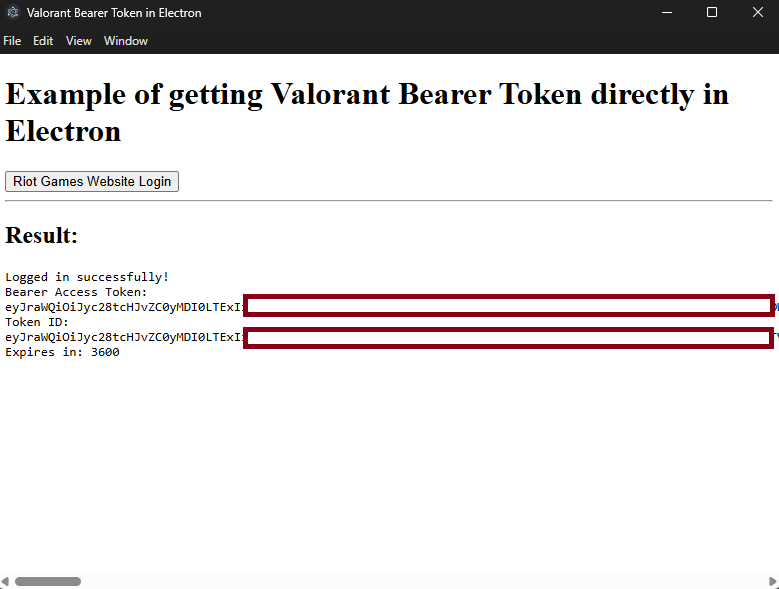
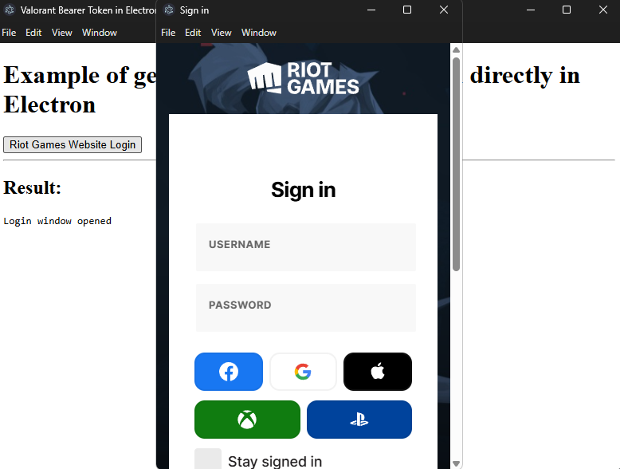
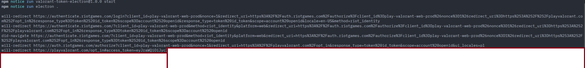

# Example of getting Valorant Bearer Token from Riot website, directly in Electron by using Cookie Reauth Method
Based on [Techchrism's Unofficial Valorant API Docs](https://github.com/techchrism/valorant-api-docs)



## Features:
- Getting Bearer Access Token, Token ID from official Valorant website

### This method is super powerful, because you don't need to worry about 2FA!
---
Requirements:
- npm

Starting:
```
$ npm install
$ npm start
```

Usage:


- Start program
- Use button to open login window
- Login to your account
- Get token!

The application tracks all 'did-navigate' and 'will-redirect' events, so you can look on them at the console:



---
This project is not affiliated with Riot Games in any way.
